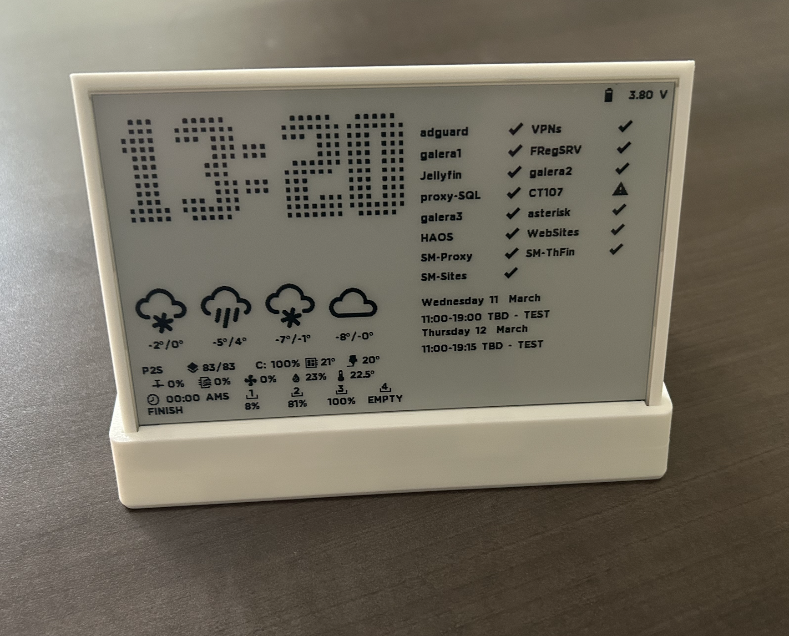
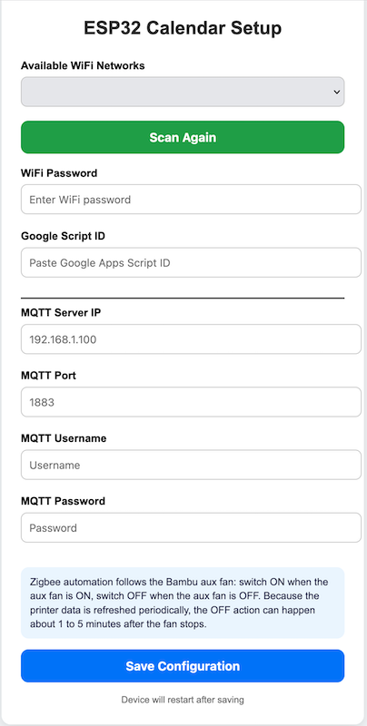

# ESP32 ePaper Desk Dashboard



A low-power desk dashboard for ESP32 boards and 7.5" ePaper displays. It shows the time, your calendars (with flights highlighted), the weather, stock prices, your parcels, your Bambu Lab printer and your MakerWorld statistics. Everything is configured from a web page served by the device itself: the ESP32 talks to each service directly, with no cloud scripts or servers in between.

## Contents

- [What it shows](#what-it-shows)
- [Hardware](#hardware)
- [Quick start](#quick-start)
- [The setup page](#the-setup-page)
- [How the screen behaves](#how-the-screen-behaves)
- [Wake button](#wake-button)
- [Building the firmware](#building-the-firmware)
- [Troubleshooting](#troubleshooting)
- [Project structure](#project-structure)

## What it shows

The ESP32 fetches every widget's data itself, directly from each service:

| Widget | Data source | Needs | Refresh |
| --- | --- | --- | --- |
| Clock | internal clock, synced over NTP | timezone | every minute |
| Top bar: battery, problems, firmware version | battery pin, fetch results | — | every hour, and whenever a problem appears or clears |
| Month calendar | your iCal feeds (marks days with events) | iCal URL | every hour |
| Upcoming events (next 24 h), flights highlighted | up to 3 iCal feeds, merged | iCal URL | every hour (flight countdown: every 10 min) |
| Weather (4 days) | [Open-Meteo](https://open-meteo.com/) | city or coordinates | every 6 hours |
| Stocks (up to 5) | Yahoo Finance | ticker symbols | every hour |
| Bambu Lab printer | the printer, over local MQTT | printer IP, serial, access code | every 4 min while printing, 10 min idle |
| MakerWorld stats | Bambu's MakerWorld API | MakerWorld user ID | every hour (idle only) |
| Package tracking (up to 3 lines) | [PKGE](https://business.pkge.net) | PKGE API key | every 2 hours |
| Live flight status (optional) | [AeroDataBox](https://rapid.aerodatabox.com) via RapidAPI | RapidAPI key | on the day of a flight: every 30 min, every 10 min around departure and landing |

Only package tracking (a PKGE Business account) and the optional live flight status (a free RapidAPI account) need an account; everything else works without keys or accounts. A widget only appears when its field on the setup page is filled in.

## Hardware

Minimum:

- an ESP32 or ESP32-C6 board
- a 7.5" GxEPD2-compatible black-and-white ePaper display (800×480)
- a Wi-Fi network

Optional:

- a LiPo battery (the battery widget reads it through a voltage divider)
- a push button or `TTP223` touch module, to refresh, reboot or reopen setup mode
- a Bambu Lab printer on the same network

Boards used during development:

- ESP32: Lolin D32
- ESP32-C6: DFRobot FireBeetle 2 ESP32-C6
- ESP32-C6 SuperMini: MakerGO-style clone

Clone boards and display hats vary, so check the pinout if yours differs. Most color ePaper panels do not support partial refresh, and large panels can take 20+ seconds for a full refresh.

### Pin reference

| Board | CS | DC | RST | BUSY | SCK | MOSI | Display power | Battery | Button |
| --- | ---: | ---: | ---: | ---: | ---: | ---: | ---: | ---: | --- |
| ESP32-C6 SuperMini | `4` | `20` | `21` | `22` | `7` | `5` | `1` | not used | `GPIO2` |
| ESP32-C6 (FireBeetle 2) | `1` | `8` | `14` | `7` | `23` | `22` | `4` | `0` | `GPIO2` |
| ESP32 | `15` | `27` | `26` | `25` | `13` | `14` | `4` | `35` | `GPIO33` |

The firmware picks the matching preset for your board automatically. You can choose another preset, or enter a custom pin map, on the setup page. Presets are defined in [configure.h](configure.h).

## Quick start

1. **Flash the firmware.** Use a [prebuilt release](https://github.com/VoIPshare/ESP32-eInk-Dashboard/releases) (flash the merged image at address `0x0000`, for example with the [espboards.dev programmer](https://www.espboards.dev/tools/program/)), or [build it yourself](#building-the-firmware).
2. **Power on the board.** The screen shows "ESP32 AP Mode".
3. **Join the Wi-Fi network `Dashboard-Setup`** from your phone or computer. The setup page opens by itself (captive portal). If it doesn't, browse to `http://192.168.4.1`.
4. **Fill in the setup page** (see below) and press **Save Configuration**. The device restarts and draws the dashboard.

To change the settings later, hold the button for 4 seconds to reopen setup mode (see [Wake button](#wake-button)).

## The setup page



| Field | What to enter |
| --- | --- |
| **WiFi network / password** | Your Wi-Fi. Leave the password empty to keep the saved one. |
| **Timezone** | A POSIX TZ string used by the clock and the calendar, e.g. `EST5EDT,M3.2.0/2,M11.1.0/2` (US Eastern), `CET-1CEST,M3.5.0,M10.5.0/3` (Central Europe), `GMT0BST,M3.5.0/1,M10.5.0` (UK). [List of TZ strings](https://github.com/nayarsystems/posix_tz_db/blob/master/zones.csv). |
| **Weather Location** | A city, optionally with a 2-letter country code (`London, GB`), or `latitude,longitude` (`51.51,-0.13`). A city is looked up once with Open-Meteo's geocoding. |
| **Stock Symbols** | Up to 5 Yahoo Finance symbols, comma separated: `AAPL,NVDA,^IXIC`. Indexes start with `^`. |
| **Calendar iCal URLs** | Up to 3 `.ics` links, merged into one calendar. See [Getting your Google Calendar link](#getting-your-google-calendar-link). |
| **Printer Name** | Title shown on the printer widget. |
| **Bambu Printer IP** | The printer's local IP address. Leave empty to hide the printer widget. |
| **Bambu MQTT Port** | `8883` (the default; MQTT over TLS). |
| **Bambu Printer Serial Number** | On the printer screen under Settings → Device, or in Bambu Studio. |
| **Bambu LAN Access Code** | On the printer screen under Settings → WLAN / Network → Access Code. Leave empty to keep the saved code. |
| **MakerWorld User ID** | The numeric ID of your MakerWorld account (see below). |
| **PKGE API Key** | The API key of your PKGE Business account, for package tracking (see [Tracking your packages](#tracking-your-packages)). Leave empty to keep the saved key; enter `-` to remove it. |
| **AeroDataBox API Key** | Optional: your RapidAPI key, for live flight status (see [Live flight status](#live-flight-status-optional)). Leave empty to keep the saved key; enter `-` to remove it. |
| **Pin Preset** | Your board's wiring. Pick **Custom** to enter your own pins. |
| **Zigbee** | Only in Zigbee builds, see [Zigbee](#zigbee-esp32-c6-only). |

Settings are stored in the board's flash and survive firmware updates, unless you erase the flash when uploading.

### Getting your Google Calendar link

1. Open [Google Calendar](https://calendar.google.com) on a computer and go to **Settings**.
2. Under **Settings for my calendars**, pick the calendar.
3. Open **Integrate calendar** and copy one of these:
   - **Public address in iCal format**: works only if the calendar is public.
   - **Secret address in iCal format**: works for a private calendar. Treat it like a password: anyone with it can read your calendar.

Any other service that publishes an `.ics` link (Outlook, iCloud, Nextcloud, …) works too.

### Flights

Flights in your calendars get a small plane icon (shown as ✈ in the examples below) and a countdown to departure. Nothing to configure: add the flight to any of your calendars with a title like one of these:

| Calendar title | Recognized because |
| --- | --- |
| `TS399 PUJ->YUL` | flight number + route |
| `AC 871 YUL to YYZ` | flight number + route |
| `WS1234 YUL→YYC`, `AC871 YUL/YYZ` | flight number + route |
| `Flight to Toronto (AC 871)` | contains the word "flight" |

A flight number is a 2-character airline code followed by 1–4 digits (`TS399`, `AC 871`); a route is two 3-letter airport codes joined by `->`, `→`, `-`, `/` or `to`. Titles containing "flight" or ✈ always count. Ordinary titles such as "PS4 game night" or "Q3 review" are not mistaken for flights. Flights added automatically by Gmail or TripIt already use these formats.

On screen:

- **More than 24 hours away (up to 7 days):** pinned at the top of the events list, e.g. `✈ TS399 PUJ->YUL  in 3d 4h`.
- **Within 24 hours:** shown in the events list with its time and a countdown, e.g. `✈ 14:05-18:30 TS399 PUJ->YUL  in 5h20m`, refreshed every 10 minutes.

Without an AeroDataBox key, the countdown uses the departure time of the calendar event, so it doesn't reflect delays.

#### Live flight status (optional)

With an AeroDataBox key, the dashboard follows the next flight from **6 hours before departure until it lands** (it stops when the flight has landed or was canceled, 1 hour after the actual landing at the latest, and for safety never more than 3 hours after the scheduled landing or after 30 requests), checking every 30 minutes (every 10 minutes in the hour around departure and around landing), and shows a second line under the flight. The first line then uses the real (gate) departure and arrival times instead of the calendar's, and the countdown includes delays:

```
✈ 14:50-19:15 TS399 PUJ->YUL  in 3h55m
  Delayed +45m, gate B7, Terminal B
```

The gate appears once the airline publishes it, usually an hour or two before departure; numeric terminals are shown short (`T1`). The line becomes `In the air, lands 19:15` after take-off, `Landed 19:12` on arrival, or `CANCELED`. Other states shown: On time, Check-in, Boarding, Gate closed, Diverted.

To get a key:

1. Create a free account at [rapidapi.com](https://rapidapi.com) (no separate AeroDataBox account is needed).
2. Open the AeroDataBox API ([rapid.aerodatabox.com](https://rapid.aerodatabox.com)) and subscribe to the free **Basic** plan.
3. Copy your **X-RapidAPI-Key** into the **AeroDataBox API Key** field on the setup page.

The flight number comes from the calendar title (`TS399`), and only the day of the flight uses requests, about 15–20 per flight. Check the plan's monthly quota on RapidAPI. If the flight can't be found or the service fails, the line falls back to the calendar time and `Flight` appears in the top bar.

### Finding your MakerWorld user ID

Open your MakerWorld profile, open your published models list, and look for the long number in the page address or in your browser's network requests to `/design-service/published/<number>/design`. That number is your user ID.

### Tracking your packages

Packages are managed in your **PKGE** account; the dashboard only reads them. You never have to type tracking numbers on the device.

1. Create an account at [business.pkge.net](https://business.pkge.net).
2. In your account, open the **Company profile → API key** section and copy the key.
3. Paste it in the **PKGE API Key** field on the dashboard's setup page.
4. Whenever you order something, add the tracking number in the PKGE web dashboard and pick the carrier (or let PKGE detect it). The dashboard picks it up within 2 hours.

The tracking widget shows one line per package: an icon (truck = in transit or preparing, box with check = delivered, ⚠ = delivery problem, plain box = anything else), the **last 8 characters** of the tracking number, the status, and the estimated delivery date when the carrier provides one. For example (the emoji stand for the icons):

```
🚚 23197428  In transit  ETA Oct 14
📦 AA101234  At pickup point
✅ 89CN0042  Delivered
```

Packages still on their way come first, newest update first. Delivered packages stay visible for 1 day after delivery, then disappear from the screen; they remain in your PKGE account, so delete them there when you no longer need them.

| PKGE status | Shown as |
| --- | --- |
| 0, 1 | Checking |
| 2 | No info yet |
| 3 | In transit |
| 4 | At pickup point |
| 5 | Delivered |
| 6 | Not delivered |
| 7 | Delivery error |
| 8 | Preparing |
| 9 | Route ended |

### Bambu Lab printer requirements

- The printer and the dashboard must be on the same network.
- The dashboard logs in with the user `bblp` and the LAN access code, like other local tools (Home Assistant, Bambu Buddy, …). On recent firmware this requires LAN mode or Developer Mode to be enabled on the printer.
- The access code can change when LAN or Developer Mode is toggled. If the printer widget stops updating, re-enter the code.

## How the screen behaves

### Built-in layout

The 800×480 screen is split like this:

| Left column (x 10–440) | Right column (x 440–800) |
| --- | --- |
| Clock (top) | Top bar: battery, problems, version |
| Stocks | Month calendar |
| Weather | Upcoming events |
| Printer / MakerWorld | Package tracking (bottom) |

### Refresh timing

- The device sleeps between updates and wakes **about half a second after every minute starts**. The clock is redrawn first, before any network activity, so the new minute appears within about 2 seconds. A quiet minute keeps the board awake for about 2 seconds.
- Wi-Fi is only turned on when a widget is due for new data (see the table at the top). The time is re-synced over NTP at least once an hour, because the internal clock drifts during deep sleep.
- To save battery, wakes that only redraw the clock run the CPU at 80 MHz, and Wi-Fi reconnects straight to the access point used last time instead of scanning every channel.
- If Wi-Fi can't connect, the device waits before trying again: 2, 4, 8, 16, then 30 minutes. A button tap always tries right away.
- If the printer doesn't answer (usually because it's off), it's retried once at the next wake, then only at its normal polling interval.
- Widgets are updated with partial refreshes. A full screen refresh, which removes ghosting, happens once a day, after setup, and after a button wake.
- If a download fails, the widget keeps showing its previous content instead of going blank.

### Top bar and problem indicator

The top bar shows, from left to right: the battery voltage, any **current problems**, the firmware version, and icons for printing, Zigbee and the battery level.

The battery level comes from a typical LiPo discharge curve (about 4.15 V = 100 %, 3.83 V = 50 %, 3.3 V = 0 %), not a straight line. The voltage is read with the chip's factory ADC calibration and averaged over 16 samples. While USB is plugged in, the charger holds the voltage high, so the icon reads full. If the voltage shown differs from a multimeter, set `BAT_CALIBRATION` in `ESP32-eInk-Dashboard.ino` to *multimeter ÷ displayed* (for example 4.12 ÷ 4.05 = 1.017). The debug log prints `[Battery] 4.05 V, 90%` on each status-bar refresh.

When a data source fails, a ⚠ icon appears next to the voltage, followed by the names of what is failing:

| Shown | Meaning |
| --- | --- |
| `WiFi` | The device couldn't join your Wi-Fi network. |
| `Time` | The hourly internet time sync failed. |
| `Weather` | The Open-Meteo forecast couldn't be loaded. |
| `Stocks` | One or more stock symbols couldn't be loaded (often a typo in a symbol). |
| `Calendar` | One or more iCal links couldn't be loaded. |
| `Printer` | The printer didn't answer (off, wrong IP, or wrong serial number). |
| `Access code` | The printer rejected the LAN access code. |
| `MakerWorld` | The MakerWorld stats couldn't be loaded. |
| `Tracking` | The package list couldn't be loaded from PKGE (often a wrong API key). |
| `Flight` | The live flight status couldn't be loaded (wrong key, quota used up, or flight not found). |

Each problem clears by itself the next time that source loads successfully. If there's not enough room, the remaining ones are summarized as `+N`. The serial log has the details (see [Troubleshooting](#troubleshooting)).

### Printer and MakerWorld panel

The bottom-left panel switches automatically:

- **While printing:** printer status: layer, progress, temperatures, fans, remaining time, AMS trays and humidity.
- **For 5 minutes after a print ends:** printer status, so you can see the finished state.
- **Otherwise:** MakerWorld totals: likes, downloads, prints, collections and boosts, summed over all your published models.

If no MakerWorld ID is set, the panel shows the idle printer status instead.

## Wake button

The button is optional. Without it, the device wakes on its timer only.

| Action | Result |
| --- | --- |
| Short tap | Wakes the device and does a full refresh |
| Hold 2 seconds, then release | Reboots the dashboard |
| Hold 4 seconds | Setup mode: starts the `Dashboard-Setup` network and the setup page |

Releasing before 2 seconds counts as a short tap; releasing between 2 and 4 seconds reboots. The holds also work while the dashboard is awake and refreshing; a short tap then is ignored. On the ESP32-C6 SuperMini, the onboard LED shows the stage: green while holding, flashing cyan from 2 s (release to reboot), flashing white at 4 s (setup). Setup mode closes by itself after 5 minutes without activity (each time the setup page is opened, the 5 minutes start again) and the dashboard resumes normally. On a device that was never configured, setup mode stays open until you save.

## Building the firmware

### Arduino IDE

1. Install the **esp32** board package by Espressif (3.3.x).
2. Install the libraries: **GxEPD2**, **Adafruit GFX Library**, **Adafruit BusIO**, **ArduinoJson** (7.x), **PubSubClient**.
3. Open [ESP32-eInk-Dashboard.ino](ESP32-eInk-Dashboard.ino) and select your board.
4. For ESP32-C6 boards, set **Tools → USB CDC On Boot → Enabled**, otherwise the serial log goes to the UART pins instead of USB.
5. Compile and upload.

### arduino-cli

The repo includes [sketch.yaml](sketch.yaml) profiles:

```bash
arduino-cli compile --profile esp32 .
arduino-cli compile --profile esp32_waveshare .
arduino-cli compile --profile esp32c6_firebeetle .
arduino-cli compile --profile esp32c6_supermini .
```

Zigbee variants (ESP32-C6 only): `esp32c6_firebeetle_zigbee` and `esp32c6_supermini_zigbee`.

To build and upload without a profile, for example for a FireBeetle 2 ESP32-C6 with the serial log on USB:

```bash
arduino-cli compile -u -p /dev/cu.usbmodem101 \
  --fqbn esp32:esp32:dfrobot_firebeetle2_esp32c6:CDCOnBoot=cdc \
  --build-property "compiler.cpp.extra_flags=-DDEFAULT_PIN_PRESET_ESP32C6_FIREBEETLE" \
  --build-property "upload.maximum_size=3604480" .
```

The Arduino IDE remembers board-menu options, but `arduino-cli` needs them in the FQBN (`CDCOnBoot`, `PartitionScheme`, `ZigbeeMode`, …).

### Compile-time options

In [configure.h](configure.h):

| Option | Default | Meaning |
| --- | --- | --- |
| `FW_VERSION` | e.g. `".59"` | Shown next to the battery indicator. CI builds can override it. |
| `DEBUG` | `1` | Serial debug log. Debug builds wait 3 s after a reset so a serial monitor can attach. |
| `USE_ZIGBEE` | `0` | Zigbee support (ESP32-C6). |
| `USE_COLORDISPLAY` | `0` | 4-color panel instead of black and white. |

Timing constants you can adjust:

| Constant | Default | File | Meaning |
| --- | --- | --- | --- |
| `BUTTON_REBOOT_HOLD_MS` / `BUTTON_SETUP_HOLD_MS` | 2 s / 4 s | [configure.h](configure.h) | Button hold times for reboot and setup mode |
| `AP_TIMEOUT_MS` | 5 min | [ESP32-eInk-Dashboard.ino](ESP32-eInk-Dashboard.ino) | Setup mode closes after this long without activity |
| `WAKE_AFTER_MINUTE_MS` | 500 ms | main sketch | Wake-up offset after each minute starts |
| `NTP_RESYNC_S` | 1 h | main sketch | Maximum time between internet time syncs |
| `MAKERWORLD_REFRESH_S` | 1 h | main sketch | MakerWorld stats refresh |
| `FLIGHT_LIVE_BEFORE_S` / `FLIGHT_LIVE_REFRESH_S` / `FLIGHT_LIVE_FAST_S` | 6 h / 30 min / 10 min | main sketch | When live flight status starts, its normal refresh, and the refresh in the hour around departure and landing |
| `FLIGHT_LIVE_AFTER_MAX_S` / `FLIGHT_LIVE_MAX_REQUESTS` | 3 h / 30 | main sketch | Safety limits: live tracking stops at the latest this long after the scheduled landing, or after this many requests for one flight |
| `PRINT_FINISHED_HOLD_S` | 5 min | [bambulab.h](bambulab.h) | Printer status stays on screen after a print ends |
| `ICS_FLIGHT_LOOKAHEAD_S` | 7 days | [directFetch.cpp](directFetch.cpp) | How far ahead a flight is pinned with a countdown |
| `TRACKING_KEEP_DELIVERED_S` | 1 day | directFetch.cpp | How long delivered packages stay visible |

The refresh interval of each widget (in minutes) is the `refresh` column of the built-in layout in [fetchAllInfo.cpp](fetchAllInfo.cpp) (`loadDefaultLayout`).

### Zigbee (ESP32-C6 only)

1. Set `USE_ZIGBEE` to `1` in [configure.h](configure.h), or use a `_zigbee` profile.
2. Select a Zigbee-capable partition scheme and Zigbee mode.
3. Enable Zigbee on the setup page and press the pairing button on your Zigbee switch.

The switch follows the Bambu aux fan: on when the fan is on, off when it stops. Because the printer is polled periodically, the off action can come 1–5 minutes after the fan stops.

### CI builds

The GitHub Actions workflow builds ESP32, ESP32-C6 and ESP32-C6 Zigbee firmware with [partitions.csv](partitions.csv), and can inject the firmware version string.

## Troubleshooting

Connect the board over USB and open a serial monitor at 115200 baud. Each widget logs what it does:

| Log line | Meaning and fix |
| --- | --- |
| `[Bambu]: MQTT fail rc=5` / `Access code rejected` | Wrong LAN access code. Re-enter it on the setup page. The device stops retrying until the next scheduled check. |
| `[Bambu]: MQTT fail rc=-2` | Printer unreachable: check the IP, that the printer is on, and that LAN / Developer Mode is enabled. |
| `[Bambu] Full report NOT received` | Connected but the printer sent nothing: check the serial number. |
| `[Direct] HTTP 404 for …finance…/XYZ` | Unknown stock symbol (e.g. `APPL` instead of `AAPL`). |
| `[Weather] Location not found` | Try `City, CC` with a country code, or coordinates. |
| `[ICS] HTTP 404` | The calendar link is wrong, or the public link is used for a private calendar. |
| `[ICS] … 0 upcoming` | Nothing in the next 24 hours. The month view still marks days with events. |
| `[MakerWorld] HTTP …` | Wrong user ID, or the service is down. Retried after an hour. |
| `[Flight] HTTP 204` or `404` | AeroDataBox doesn't know that flight number on that date: check the title (`TS399`) and the event's date. |
| `[Flight] HTTP 401` / `403` / `429` | Wrong RapidAPI key, not subscribed to AeroDataBox, or monthly quota used up. |
| `[Tracking] HTTP 401` | Wrong PKGE API key. Copy it again from your PKGE Business account. |
| `[Tracking] … showing 0` | No package on its way and none delivered in the last day. |
| `NTP NOT synced` | No internet time this wake. The clock keeps running and re-syncs later. |
| `WiFi FAILED → keeping the previous content` | Wrong Wi-Fi password or weak signal. Widgets keep their last content and `WiFi` appears in the top bar. |

The setup page doesn't open automatically: browse to `http://192.168.4.1` while connected to `Dashboard-Setup`. Some phones ask whether to stay on a network without internet; answer yes.

The clock shows the wrong hour: set the **Timezone** field. Without it the clock shows UTC.

### Known limitations

- Yahoo Finance isn't an official API and can change or rate-limit without notice.
- The iCal reader supports single, all-day and repeating events (daily, weekly on chosen days, monthly including "2nd Tuesday", yearly), with interval, end date, count, excluded dates and cancelled events. An occurrence that was edited individually can show twice, and events with their own timezone are shown in the dashboard's timezone.
- Calendar feeds include all past events, so a calendar with years of history takes longer to download.
- Live flight status depends on AeroDataBox's coverage of the airline and on the RapidAPI plan's monthly quota.

### Privacy

The device only talks to: your Wi-Fi network, NTP time servers, `open-meteo.com`, `query1.finance.yahoo.com`, your calendar provider, `api.bambulab.com` (MakerWorld stats), `api.pkge.net` (package tracking), `aerodatabox.p.rapidapi.com` (live flight status, only on flight days) and your printer on the local network. All settings stay on the device; nothing personal is stored in the source code.

## Fonts

Font tooling and conversion notes are in [fonts/README.md](fonts/README.md): conversion scripts, glyph lists, Material Design icon setup, and ePaper font optimization notes. Glyph order must stay consistent.

## 3D-printed case

- [MakerWorld enclosure model](https://makerworld.com/en/models/2443888-epaper-dashboard-7-5-with-esp32-desktop-version)

## Project structure

- [ESP32-eInk-Dashboard.ino](ESP32-eInk-Dashboard.ino): main sketch: setup page, wake/sleep cycle, refresh scheduling
- [directFetch.cpp](directFetch.cpp): data fetching: Open-Meteo, Yahoo Finance, iCal parser, MakerWorld, PKGE tracking, AeroDataBox flight status
- [fetchAllInfo.cpp](fetchAllInfo.cpp): screen layout and widget drawing
- [bambulab.cpp](bambulab.cpp): printer status over MQTT
- [monthView.cpp](monthView.cpp): month calendar widget
- [dash_zigbee.cpp](dash_zigbee.cpp): Zigbee integration
- [configure.h](configure.h): compile-time options, pin presets, icon constants

## Licenses and attribution

Material Design Icons: [materialdesignicons.com](https://materialdesignicons.com/), Apache 2.0.

Montserrat: [Google Fonts](https://fonts.google.com/specimen/Montserrat), SIL Open Font License 1.1.

HighSpeed: [dafont.com/high-speed.font](https://www.dafont.com/high-speed.font), free for personal use; commercial use requires permission.

## Contributing

Contributions are welcome: new widgets, layout and UI polish, performance tuning, network and parsing robustness, documentation. Open an issue or submit a pull request.
